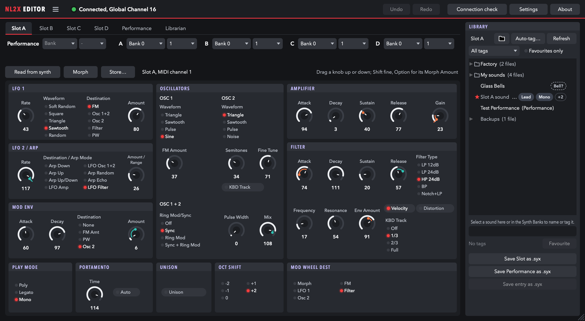

# NL2X Editor

An editor for the Nord Lead 2X: a free, open-source VST3/AU plugin and standalone app for macOS that lets you edit every sound parameter of the four Slots from your DAW, automate them, keep your sounds in a Library of `.syx` files and write them into the synth's Banks.



## Features

- Every sound parameter of Slots A–D, Morph Amounts included.
- Two-way: the synth's panel and the editor follow each other.
- Every parameter is a DAW parameter, for automation and controller mapping.
- Your DAW project recalls the synth's sounds.
- Bank, Program and Performance selectors.
- Connection check that says what to fix.
- Library of your `.syx` files, with names, tags, favourites and instant Audition.
- Librarian for the synth's Banks 0–3, with automatic backups.
- Undo and redo.
- Saves Slots, Performances and Banks as standard `.syx` files.

How each feature works: [user guide](docs/user-guide.md).

## Requirements

- macOS 11 or later.
- An Intel or Apple Silicon Mac.
- A DAW that hosts VST3 or Audio Unit instruments, or the standalone app.
- A Nord Lead 2X or Nord Rack 2X, connected through a MIDI interface with both MIDI In and MIDI Out.

## Installation

Version 0.1.0-beta.1 (beta). Download the formats you need, unzip and copy:

- [VST3 plugin](https://github.com/andreastandalone/nl2x-editor/releases/download/v0.1.0-beta.1/NL2X-Editor-VST3.zip): copy `NL2X Editor.vst3` to `/Library/Audio/Plug-Ins/VST3/`
- [Audio Unit plugin](https://github.com/andreastandalone/nl2x-editor/releases/download/v0.1.0-beta.1/NL2X-Editor-AU.zip): copy `NL2X Editor.component` to `/Library/Audio/Plug-Ins/Components/`
- [Standalone app](https://github.com/andreastandalone/nl2x-editor/releases/download/v0.1.0-beta.1/NL2X-Editor-App.zip): copy `NL2X Editor.app` to `/Applications/`

To reach a folder, choose Go > Go to Folder... in the Finder. Then restart your DAW.

### Opening it the first time

1. Open the app, or load the plugin in your DAW. macOS blocks it: click **Done**.
2. Open System Settings > **Privacy & Security**, scroll down and click **Open Anyway** next to "NL2X Editor was blocked".
3. Open it again and click **Open Anyway**.

Repeat for each format you installed. Or run in Terminal the lines for the files you copied:

```sh
sudo xattr -dr com.apple.quarantine "/Library/Audio/Plug-Ins/VST3/NL2X Editor.vst3"
sudo xattr -dr com.apple.quarantine "/Library/Audio/Plug-Ins/Components/NL2X Editor.component"
sudo xattr -dr com.apple.quarantine "/Applications/NL2X Editor.app"
```

## MIDI settings

1. Connect the interface's MIDI Out to the synth's MIDI In, and the synth's MIDI Out to the interface's MIDI In.
2. In your DAW, insert NL2X Editor as an instrument on a MIDI track.
3. In the editor, click **Settings** and choose the MIDI input and output ports.
4. Play the synth from a MIDI track routed to it, as usual, and listen to it through your audio interface.

## Synth settings

1. Hold **Shift** and press **PROG/CTRL** repeatedly; set **P** on, **C** on and **A** off with UP/DOWN.
2. Give each Slot its own MIDI channel: **Shift + MIDI CH**, press the Slot's button, set the channel with UP/DOWN (for example A = 1, B = 2, C = 3, D = 4).
3. Set the Global Channel to a channel no Slot uses: **Shift + MIDI CH**, then **MIDI CH** again (the display shows `G.x`), and set 16 with UP/DOWN.

## Reporting problems

Open an issue on [GitHub Issues](https://github.com/andreastandalone/nl2x-editor/issues) with: the editor's version (About), your macOS version and Mac (Intel or Apple Silicon), the DAW and its version (or the standalone app), the format (VST3 or AU), your MIDI interface, what you did, what you expected and what happened.

Building from source and contributing: [docs/development.md](docs/development.md).

## Licence

NL2X Editor is free software under the [GNU AGPLv3](LICENSE), with no warranty. It is built with [JUCE](https://juce.com), used under the AGPLv3.

Nord, Nord Lead and Clavia are trademarks of Clavia DMI AB; NL2X Editor is not affiliated with or endorsed by Clavia DMI AB. VST is a trademark of Steinberg Media Technologies GmbH.
